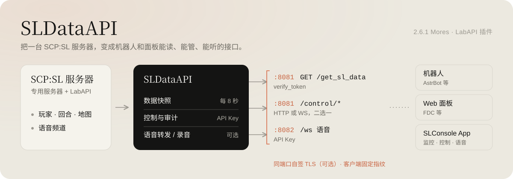

<picture>
  <source media="(prefers-color-scheme: dark)" srcset="docs/assets/sldataapi-overview-dark.svg">
  
</picture>

SCP:SL 专用服务器的 **LabAPI 原生插件**。对外提供 HTTP 数据查询、远程控制、控制 WebSocket 事件流、语音转发与录音取证。

常见问题见 Wiki **[Q&A](https://github.com/DNTOF/SLDataAPI/wiki/Q%26A)**。


## 能力概览

| 能力 | 说明 |
|------|------|
| 数据查询 | `GET /get_sl_data`：人数、回合、核弹、玩家（SteamID/坐标）、游戏版本与当前节日（`game_version` / `active_holiday`）、DNT_OF 插件状态；`GET /plugins/adapted` + `adapted_plugins` 适配插件发现 |
| 控制接口 | `/control/*`：玩家 / 物品栏 / 管理 / 回合 / 地图（含设施状态快照、灯光颜色）/ CASSIE / 全服广播 / 管理聊天 / 控制台 / 插件 / 文件 / 日志 / 举报等；HTTP 或 WS 二选一。`/control/player/data` 含生命 / 护盾 / 体力 / 物品 / 弹药 / 当前效果与 TemporaryBypass 开门权限 |
| 节日 | 万圣节糖果 / 棉花糖人 / 节日物品：按游戏当前节日自动可用，未开启时返回结构化 `409 holiday_inactive`，无需改代码 |
| 事件流 | 控制 WS 订阅：回合、进出、死亡、角色变化、逃脱、封禁 / 踢出、重生波次、核弹、去污、发电机、SCP 收容播报、举报等 |
| 语音转发 | 独立端口 WS，全频道 48kHz PCM（SPY） |
| 语音录音 | 分轨 WAV + 时间轴 TSV，按局保留；可选 WebDAV（仅 https）自动上传定稿 zip |
| 举报 | Esc 服务器设置面板 + `/control/reports`（默认关） |
| 审计 | 侵入性控制操作写入 `control_log.json`（默认开） |

## 运行依赖

插件运行时需要两个程序集：

| 依赖 | 版本 | 缺失现象 |
|------|------|----------|
| `0Harmony.dll` | 2.3.x（建议与 LabAPI 自带一致） | 插件加载失败 / 事件补丁不生效 |
| `Newtonsoft.Json.dll` | 13.0.x（程序集版本 13.0.0.0） | 插件加载失败 / 启动即崩 |

**放置位置**（所有端口共享的全局依赖目录）：

```
%AppData%/SCP Secret Laboratory/LabAPI/dependencies/global/0Harmony.dll
%AppData%/SCP Secret Laboratory/LabAPI/dependencies/global/Newtonsoft.Json.dll
```

**获取渠道：**

- `0Harmony.dll`：Harmony 官方仓库 https://github.com/pardeike/Harmony/releases （选择 **net472** 版本，文件名为 `0Harmony.dll`）
- `Newtonsoft.Json.dll`：NuGet https://www.nuget.org/packages/Newtonsoft.Json （13.0.x）

放入后重启服务器生效。

---

## 安装 / 升级

1. 从 [最新 Release](https://github.com/DNTOF/SLDataAPI/releases/latest) 下载 `SLDataAPI.dll`（或自行 `dotnet build -c Release`，见 [Building](https://github.com/DNTOF/SLDataAPI/wiki/Building)）
2. 确认上方两个依赖已就位
3. 升级前备份 `config.yml` 与 `apikey.config`
4. 将 `SLDataAPI.dll` 放入 `%AppData%/SCP Secret Laboratory/LabAPI/plugins/global/`
5. 启动服务器生成配置，**把 `verify_token` 改成强随机值**后重启
6. 需要控制面时：本地控制台执行 `sldataapi apikey create <id> admin`（或 `duty`）
7. 防火墙按需放行 `http_port`（及启用时的 `voice_port`）

从旧版 `control_token` 鉴权升级：控制端改用 API Key、路径改为 RA 对齐分组，对照表见 Wiki [HTTP-API](https://github.com/DNTOF/SLDataAPI/wiki/HTTP-API)。

---

## 配置（摘要）

路径：`LabAPI/configs/<端口或 global>/SLDataAPI/config.yml`（键名 **snake_case**）。

```yaml
debug: false
verify_token: "your_secret_token"   # 必须改成强随机值；默认/弱口令会 fail-closed 关闭数据口
http_port: 8081
push_interval_seconds: 8
tls_mode: optional                  # off | optional | required：同端口自签 TLS（见下文「TLS」）

control_enabled: false              # 关则所有 /control/* → 404
control_transport: http             # http | ws（硬互斥）
# control_token 已废弃：写了也会被忽略并警告

auto_update_check: true             # 启动 + 默认 72h 静默复查 GitHub Releases
auto_update_install: true           # 仅稳定正式包；未强签名构建拒绝自动安装
# auto_update_check_interval_hours: 72

voice_enabled: false
voice_port: 8082
voice_record_enabled: false

webdav_upload_enabled: false        # 定稿 zip 自动上传（默认关）
webdav_url: ""                      # 仅 https:// 目录 URL，或含 {filename} 的模板
webdav_username: ""
webdav_password: ""

report_enabled: false
control_log_enabled: true
# apikey_copy_to_clipboard: false   # Windows 创建 Key 后是否复制剪贴板（默认关）
```

完整字段、YAML 坑、token 写法见 Wiki [Configuration](https://github.com/DNTOF/SLDataAPI/wiki/Configuration)。

---

## 鉴权

| 通道 | 凭据 | 配置位置 |
|------|------|----------|
| `GET /get_sl_data`、`GET /plugins/adapted` | `verify_token`（`Authorization: Bearer` / `X-SLDataAPI-Token`；`?token=` 兼容但已弃用） | `config.yml` |
| `/control/*`、控制 WS、语音口 | **API Key** | `apikey.config`（同配置目录，仅存指纹） |

控制面请求头（二选一）：

```http
Authorization: Bearer <api_key>
X-SLDataAPI-Key: <api_key>
```

不再接受：`X-Control-Token`、控制面 URL `?token=` / `?key=`。

### 管理 API Key（仅本地控制台）

```text
sldataapi apikey create <id> <duty|admin> [note]
sldataapi apikey list
sldataapi apikey revoke <id>
```

- `apikey` 子命令**仅限服务器本地控制台（LocalAdmin）**：RemoteAdmin 与远程控制通道一律拒绝（与 `cert` 对齐）。`sldataapi` / `slda` 经远程控制通道（HTTP 与 WS 的 `/control/console/command`）亦一律拒绝。
- `create` 成功后明文写入配置目录的 `apikey_once_<id>.txt`，命令只回文件路径，不回密钥；文件约 **5 分钟后自动删除**，请尽快存进密码管理器。
- 丢失明文无法找回，只能 `revoke` 后重新 `create`。
- `duty` 偏只读，默认不授予 `/control/audit/list`、广播、管理聊天；`admin` 按端点目录授权，控制台 / 插件 / 文件等需 `endpoints_override` 单独放开。
- 权限插件收窄 RemoteAdmin 时仍建议同时拒绝 `sldataapi` / `slda`（其它子命令）。

### TLS（自签，同端口）

- `tls_mode: optional`（默认）时，HTTP/WS 主端口与语音端口**同端口**同时接受 TLS 与明文：首字节为 TLS 握手（`0x16`）走 TLS 1.2，否则按明文处理；`https://` / `wss://` 与 `http://` / `ws://` 用同一个端口。
- 首次启动在配置目录生成 `sld_tls.pfx` 与随机口令文件 `sld_tls.pwd`（RSA-2048 / SHA-256 / 约 10 年，`CN=SLDataAPI`；Windows 上文件权限暂未收紧，请自行限制配置目录访问）。启动日志打印 `TLS: <mode>, SHA-256 <指纹>`；客户端应固定（pin）该指纹，而不是信任 CA。
- 控制 WS 与语音 WS 的 `hello` 增加 `tls`（本连接是否加密）与 `cert_fingerprint`（`tls_mode: off` 时为 `null`）。
- `tls_mode: required`：明文 HTTP、明文控制 WS / 语音 WS 一律 `426`，`{"success":false,"message":"…","data":{"code":"tls_required"}}`。
- `tls_mode: off`：不生成/加载证书，行为与旧版一致。

```text
sldataapi cert show     # 查看模式 / 指纹 / 有效期
sldataapi cert regen    # 重新生成并热替换（仅对新连接生效；已 pin 的客户端须重新确认指纹）
```

- `cert` 子命令**仅限服务器本地控制台（LocalAdmin）**：RemoteAdmin 与远程控制通道一律拒绝（与 `apikey` 相同）。`regen` 写入控制审计日志。

---

## 接口入口

| 类型 | 地址 |
|------|------|
| 数据 | `GET http://<host>:8081/get_sl_data` + `Authorization: Bearer <verify_token>` |
| 控制 HTTP | `POST http://<host>:8081/control/...` + API Key 头 |
| 控制 WS | `ws://<host>:8081/control` + 握手 API Key 头（`control_transport: ws`） |
| 语音 | `ws://<host>:8082/ws` · `GET :8082/status` + API Key |
| TLS | 以上均可同端口改用 `https://` / `wss://`（`tls_mode` 非 `off` 时；自签证书，按指纹固定） |

全服广播示例：

```http
POST /control/broadcast
Authorization: Bearer <admin_key>
Content-Type: application/json

{"message":"服务器将于 5 分钟后重启","duration_seconds":10}
```

完整端点表与 curl 示例：[HTTP-API](https://github.com/DNTOF/SLDataAPI/wiki/HTTP-API)。WS 协议与语音帧：[WS-Control-Protocol](https://github.com/DNTOF/SLDataAPI/wiki/WS-Control-Protocol) · [Voice-Forwarding](https://github.com/DNTOF/SLDataAPI/wiki/Voice-Forwarding)。

`/control/dummies`（假人，admin）：

```http
POST /control/dummies
Authorization: Bearer <admin_key>
Content-Type: application/json

{"action":"spawn","nickname":"Bot","role":"ClassD"}
```

`action`: `spawn` | `list` | `remove`。同时最多 5 个；`remove` 的 `target` 为假人 PlayerId / 昵称，或 `all`。

---

## AstrBot

插件：[astrbot_plugin_sl_query](https://github.com/DNTOF/astrbot_plugin_sl_query)。`/bindlab <IP> <verify_token>` 后 `/sl` 显示 `[LAB]` 标记。

---

## 开发

[Development-Guide](https://github.com/DNTOF/SLDataAPI/wiki/Development-Guide) · [Architecture](https://github.com/DNTOF/SLDataAPI/wiki/Architecture) · [Building](https://github.com/DNTOF/SLDataAPI/wiki/Building)

开发 skill 与冒烟脚本：[最新 Release](https://github.com/DNTOF/SLDataAPI/releases/latest) 附件 `SLDataAPI-DevKit-v<版本>_<代号>.zip`。

---

## 支持

- QQ 群：984840871
- Issues：https://github.com/DNTOF/SLDataAPI/issues

## 许可证

Copyright (C) 2026 DNT_OF

以 [GPL-3.0-only](LICENSE) 授权，详见 [NOTICE](NOTICE)。

复用或改写本项目代码（尤其语音流相关实现）时，须保留源文件版权头与 NOTICE、以 GPL-3.0-only 开源，并注明来自 [DNTOF/SLDataAPI](https://github.com/DNTOF/SLDataAPI)。
